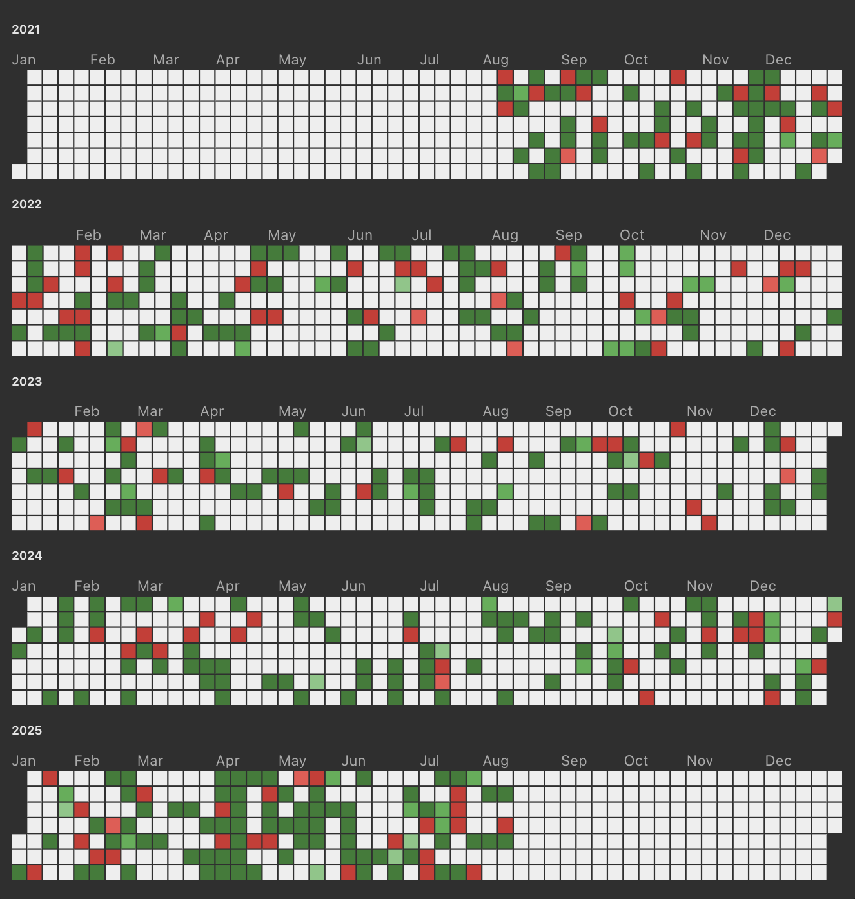
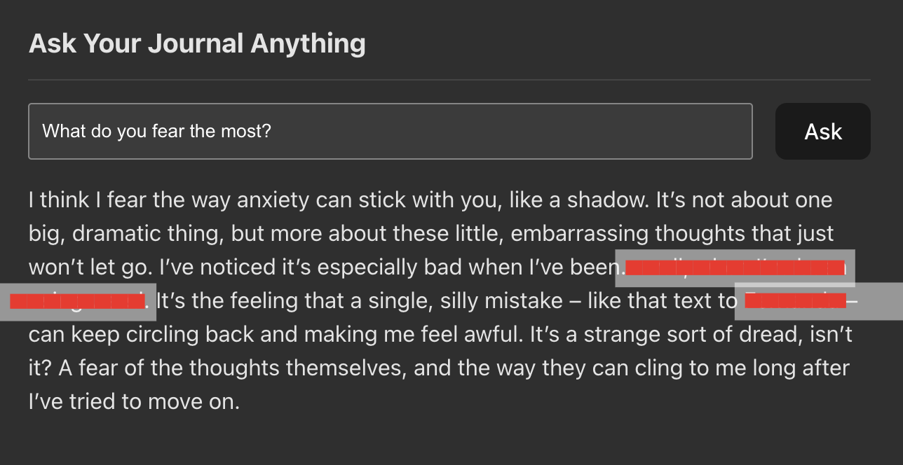
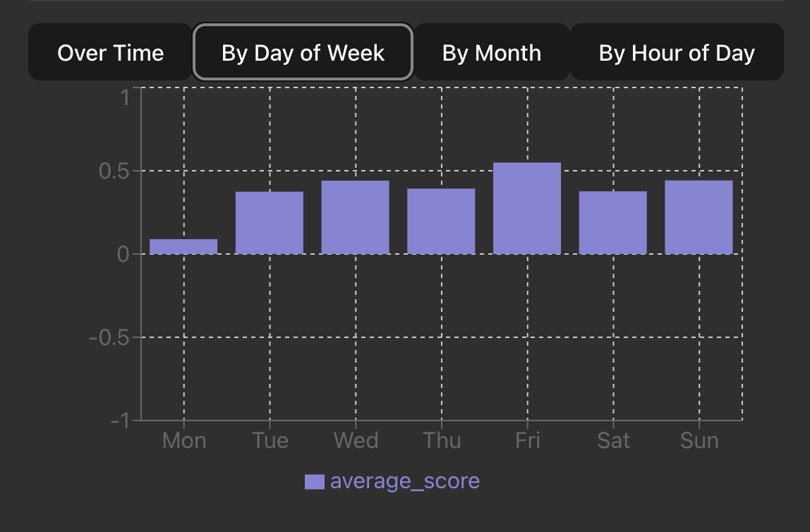
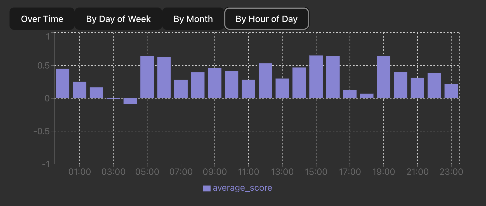

# Smriti: The Entire History of You

*An intimate, local-first, and privacy-focused intelligence for your personal journal. Visualize, explore, and talk to your past.*

[](LICENSE.md)
[](https://github.com/bvrvl/Smriti)
[](https://discord.gg/khSjjmBDTp)

### [Read the Blog Post & My Story Behind Smriti](https://bvrvl.com/posts/smriti.html)

I have been journaling since I was 10. A few years ago, I digitized everything, creating an archive of over 500 entries spanning my life. I was struck by two episodes of Black Mirror: "The Entire History of You" (a memory archive) and "Be Right Back" (a digital resurrection). I realized I had accidentally created the source material for both.

So, I decided to build it. I named it **Smriti**—Sanskrit for memory.

---

### ⚠️ Active Early Development
This project is evolving rapidly. **Features may break, change, or disappear.** It is not yet ready for general use, but you are welcome to explore and contribute.

---

## Your Data, Your Machine. Period.
Smriti's stance on privacy is simple: **your data is yours.** It is designed from the ground up to be a completely private, local-first application.

- **100% Local First:** All models, data, and processing happen on your machine. Nothing is ever sent to the cloud.
- **Zero Persistence:** The application database exists only in temporary memory while the app is running. It is **completely destroyed** when you shut it down, leaving no trace.

---

## See Smriti in Action

### A GitHub Contribution Chart for Your Feelings
Visualize your emotional history. Red days were rough; green days were better.


### Talk to Your Past Self
Smriti runs a language model locally to answer questions based *only* on the context from your journal. It's like having a conversation with a digital ghost of who you were.
**Me:** *What do you fear the most?*


### Uncover Emotional Patterns
Discover *when* you felt a certain way by grouping entries by weekday, hour, or month.




---

## Key Features

-   💬 **Generative Q&A:** Ask your journal anything and get answers based on your own words.
-   🔍 **Semantic Search:** Find memories by meaning and feeling, not just keywords.
-   📊 **Emotional Landscape:** Visualize your sentiment over time with interactive heatmaps and charts.
-   🔗 **Connection Engine:** Discover hidden relationships between people, places, and ideas.
-   🏷️ **Automated Insights:** Automatically discover recurring topics and named entities (`People`, `Places`, `Organizations`).

---

## Getting Started

**Prerequisites:** You must have **Git**, **Docker**, and **Docker-Compose** installed. For the demo, you'll also need **Python 3**.

### 1. Clone the Repository
```bash
git clone https://github.com/bvrvl/Smriti.git
cd Smriti
```

### 2. Set Up Your Hugging Face Token
To download the language model, you must agree to Google's Gemma license terms.

1.  Visit the [Gemma 3 4B IT model page](https://huggingface.co/google/gemma-3-4b-it) and accept the terms.
2.  Generate a Hugging Face Access Token with `Read` permissions.
3.  Create a file named `.env` in the project root and add your token:
    ```env
    HF_TOKEN=hf_xxxxxxxxxxxxxxxxxxxxxxxxxxxx
    ```

### 3. Prepare Your Journal Data

You have two options: use the demo diary or add your own entries.

#### **Option A: Run the Demo with Anne Frank's Diary**

This repository includes pre-processed entries from *The Diary of a Young Girl* for a powerful demonstration. To use them, create a `data` directory and copy the demo files into it.

From your terminal in the project root, run:
```bash
# Create the data directory
mkdir data

# Copy the demo entries into it
cp -r anne_frank_diary_entries/* data/
```
This will create a `data/` directory filled with the formatted diary entries, ready for Smriti to analyze.

#### **Option B: Use Your Own Journal**
Place your journal entries as `.txt` or `.md` files inside a `data/` directory in the project root. Smriti will parse the creation date from metadata (e.g., `Created: August 11, 2024 7:11 AM`) or the filename (e.g., `2024-08-11.md`).

### 4. Build and Run the Application
With Docker running, execute the following command from the project root:
```bash
docker compose up --build
```
-   **Note:** The first build will take a while as it downloads the ~3GB language model. Subsequent builds are much faster.
-   Once complete, access the Smriti frontend at **[http://localhost:5173](http://localhost:5173)**.

---

## Tech Stack
-   **Backend:** **FastAPI** (Python) with **SQLAlchemy**
-   **Frontend:** **React** (TypeScript) with **Vite**
-   **Containerization:** **Docker** and **Docker-Compose**
-   **LLM Engine:** **`llama-cpp-python`** running **Google's Gemma 3 4B-IT** (GGUF)
-   **NLP & Embeddings:** **Sentence-Transformers**, **spaCy**, **NLTK**, **Gensim**

---

## Roadmap: The Future of Smriti
The vision is to provide the deepest possible personal insight. Features being explored include:

-   **Uncovering Internal Contradictions:** Automatically identify moments of cognitive dissonance across your journal history to illuminate areas for personal growth.
-   **Mapping Core Beliefs & Values:** Move beyond *what* you wrote to understand *why* you wrote it by identifying the persistent, underlying belief systems that guide your reflections.

If you're an engineer or researcher excited by these challenges, your contributions are welcome!

---

## Technical Notes & Credits
-   **Gemma 3 Model:** This project uses a quantized GGUF version of Gemma 3 provided by [@bartowski](https://huggingface.co/bartowski) on Hugging Face, enabling it to run on consumer hardware.
-   **LLM Backend:** As of July 2025, Gemma 3 support is not yet in the main `llama-cpp-python` library. This project relies on an experimental fork from GitHub user [@kossum](https://github.com/kossum). The backend `Dockerfile` is configured to use these specific community dependencies.

---

## Contributing
Contributions, ideas, and feedback are welcome. Please open an issue or submit a pull request.
> *Led and developed by [@bvrvl](https://github.com/bvrvl) as part of [**Kritim Labs**](https://github.com/kritim-labs), an independent creative technology studio.*

## License
This project is licensed under the MIT License. See the [LICENSE](LICENSE.md) file for details.